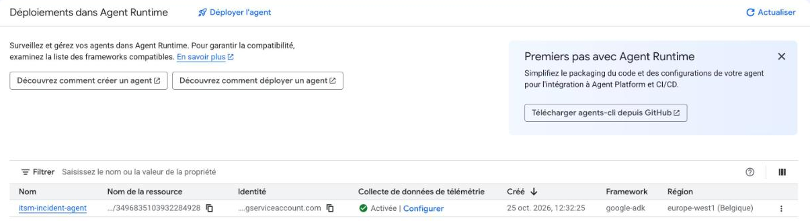
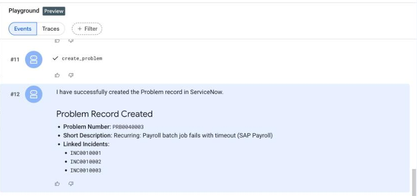
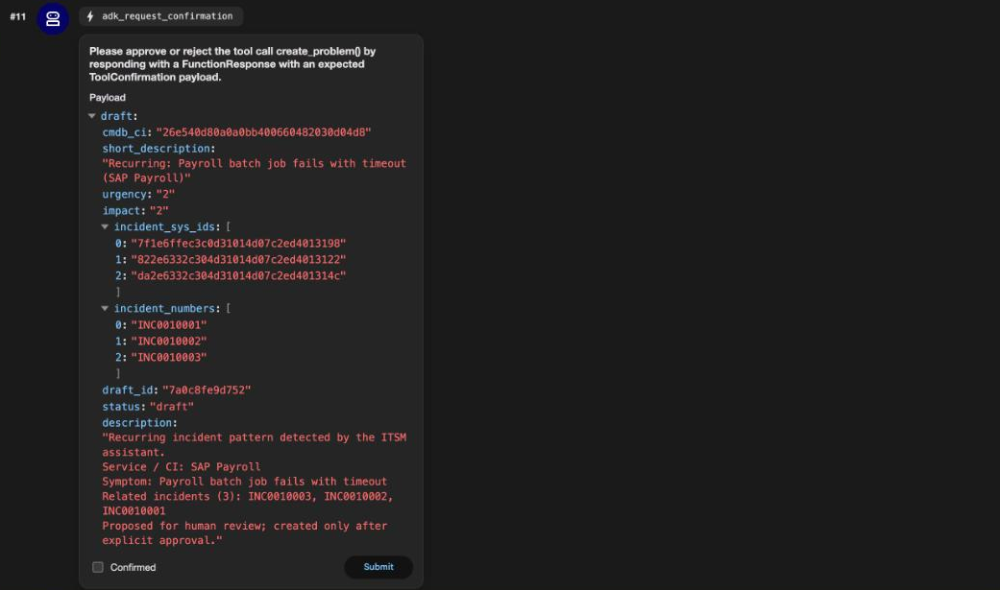

# ITSM Incident Agent — Google ADK on Gemini Enterprise Agent Platform

Support managers juggle incident lists and recurring failures by hand. This agent reads ServiceNow,
detects recurrences (same configuration item, same symptom), proposes a Problem record, and **writes only
after explicit human approval**.

A personal prototype built with the **Google Agent Development Kit (ADK)** and deployed on **Agent Runtime,
Gemini Enterprise Agent Platform** (the platform formerly known as Vertex AI Agent Engine), in the EU.



## Demo scenario (3 minutes)

1. *"Which open incidents concern the payroll application this week?"*
2. The agent queries the ServiceNow Table API, lists the open incidents and detects a recurrence:
   three incidents on the **SAP Payroll** service with the same symptom.
3. It **proposes** a Problem record (title, CI, impact/urgency, linked incidents) and asks for approval.
   Nothing is written.
4. On an explicit *"Yes, create it."* in a **later turn**, it creates the Problem, links the incidents and
   summarizes what it did.



The same scenario runs locally (`adk web`), from the Agent Platform console Playground, and from the
deployed agent's API (`deploy/query.py`).

## Architecture

```
User
  │
  ▼
Root agent (Google ADK, Gemini 3.5 Flash on the `eu` multi-region endpoint)
  ├── tool: list_incidents(search_text)            → ServiceNow Table API (GET)
  ├── tool: detect_recurrence(incidents)           → local Python, no network
  ├── tool: propose_problem(...)                   → returns a draft with a draft_id, writes nothing
  └── tool: create_problem(draft, confirmed)       → ServiceNow Table API (POST problem, PATCH incidents)
        guarded by before_tool_callback: matching draft, proposed in an EARLIER turn, confirmed=true
  │
  ▼
Agent Runtime, Gemini Enterprise Agent Platform — europe-west1 (Belgium), managed sessions
```

See [docs/architecture.md](docs/architecture.md) for the design discussion.

## Stack

| Layer | Choice |
|---|---|
| Agent framework | Google ADK 2.13 (Python) |
| Model | Gemini 3.5 Flash, `eu` multi-region endpoint |
| Runtime | Agent Runtime on Gemini Enterprise Agent Platform, `europe-west1` |
| Sessions | Agent Platform managed sessions (automatic for ADK agents) |
| External system | ServiceNow Personal Developer Instance, Table API (incident, problem, cmdb_ci) |
| Auth to ServiceNow | Dedicated service account `adk_svc` (identity type *Machine*, roles `itil` + `snc_basic_auth_api_access`), basic auth over HTTPS |
| Auth to Google Cloud | Application Default Credentials locally; the runtime's service identity when deployed. No API key anywhere. |

## Repository layout

```
itsm_agent/          the ADK agent package
  agent.py           root_agent, instruction, tools, approval guard (before_tool_callback)
  tools.py           the four tools and the ServiceNow Table API helpers
deploy/
  deploy.py          deploy to Agent Runtime (python -m deploy.deploy)
  query.py           talk to the deployed agent (python -m deploy.query "<message>" [session_id])
scripts/
  seed_demo_data.py  create the five demo incidents (correlation_id = adk-demo)
docs/
  architecture.md    design decisions, limitations, next steps
  screenshots/       console, Playground, adk web and ServiceNow evidence
.env.example         every variable the agent needs, with no value
requirements.txt     pinned dependencies
```

## Run locally

```bash
python3 -m venv .venv && source .venv/bin/activate
pip install -r requirements.txt

gcloud auth login
gcloud auth application-default login
gcloud config set project <your-project-id>

cp .env.example .env            # then fill in the values
python scripts/seed_demo_data.py   # optional: creates the five demo incidents in your ServiceNow instance
adk web                         # http://127.0.0.1:8000, pick itsm_agent
```

Locally, `create_problem` is additionally wrapped in the ADK **Tool Confirmation** flow
(`FunctionTool(..., require_confirmation=True)`): `adk web` shows a confirmation dialog with the full draft
before the tool runs.



## Deploy to Agent Runtime

```bash
gcloud services enable aiplatform.googleapis.com storage.googleapis.com
gcloud storage buckets create gs://<project-id>-staging-ew1 --location=europe-west1 --uniform-bucket-level-access

export STAGING_BUCKET=gs://<project-id>-staging-ew1
python -m deploy.deploy          # prints the reasoningEngine resource name (~5 min)

# put the resource name in .env as AGENT_RESOURCE_NAME, then:
python -m deploy.query "Which open incidents concern the payroll application this week?"
python -m deploy.query "Yes, create it." <session_id>
```

The deployed agent is also reachable from the console: *Agent Platform → Deployments → itsm-incident-agent →
Playground*.

## Design decisions

**Propose / confirm, enforced by code, not by the prompt.** Writing is a separate tool from proposing. On
Agent Runtime the write is guarded by a `before_tool_callback` that refuses `create_problem` unless a draft
with the same `draft_id` was proposed in an *earlier* invocation (so a user message necessarily sits between
proposal and write) and `confirmed=true` is passed. The `draft_id` is a hash of the draft content: if the
model alters a field between proposal and write, the hash no longer matches and the write is refused.
Locally, the ADK Tool Confirmation dialog adds a framework-level pause on top. The prompt instructs the same
behaviour, but we never rely on the prompt alone.

**Why the ADK Tool Confirmation flow is local-only.** On Agent Runtime the confirmation request is emitted
but the managed session service does not yet expose a way to answer it (the console Playground shows
"Approval requested" with no button). The deployment therefore disables the UI flow at build time
(`ADK_REQUIRE_TOOL_CONFIRMATION=0`, set *before* the agent object is pickled) and relies on the session-state
guard.

**EU data residency, at two levels.** The agent runs in `europe-west1`. The model is pinned to the `eu`
multi-region endpoint through `Gemini(client_kwargs={"location": "eu"})`, independently of the runtime
region: EU processing with pay-as-you-go quota. Single EU regions such as `europe-west3` are sized for
provisioned throughput and returned `429 RESOURCE_EXHAUSTED` within minutes during development.

**Identity and least privilege on the ServiceNow side.** The agent never uses `admin`. It authenticates
with a dedicated service account (`adk_svc`, identity type *Machine*) holding `itil` and
`snc_basic_auth_api_access` — recent instances restrict basic authentication by default. Every write is
audited under that account's name. The production path would be OAuth 2.0 client credentials (ServiceNow's
*AI* identity type requires token-based authentication).

**Secrets.** No credential lives in the code or in git history. Locally, `.env` (ignored). On the platform,
environment variables set at deploy time. Next step: Secret Manager references in `env_vars`
(`{"secret": ..., "version": ...}`) so that secrets are not readable in the console by project viewers.

**One agent, four tools.** Simpler to explain and to audit. ADK supports sub-agents; a natural extension is
a reader agent and a writer agent with different identities.

## Limitations

- Personal prototype on a ServiceNow developer instance with seeded demo data; not production.
- No end-to-end user identity: the agent acts as one service account, not as the support manager.
- `list_incidents` filters on open states and a text search; the "this week" time window is not implemented.
- Basic authentication to ServiceNow (OAuth 2.0 would be the target).
- Secrets passed as plain environment variables at deploy time (Secret Manager would be the target).
- ADK Tool Confirmation is experimental and not actionable on Agent Runtime; the session-state guard covers
  the deployed path.
- Observability: traces are visible in `adk web`; Cloud Trace integration on the platform was not explored.

## What I would do next

Secret Manager references; OAuth 2.0 client credentials to ServiceNow; a time window in `list_incidents`;
ADK evaluation sets for the propose/confirm behaviour; a reader/writer split with sub-agents; exposing the
agent in the Gemini Enterprise app.

## License

MIT — see [LICENSE](LICENSE).
